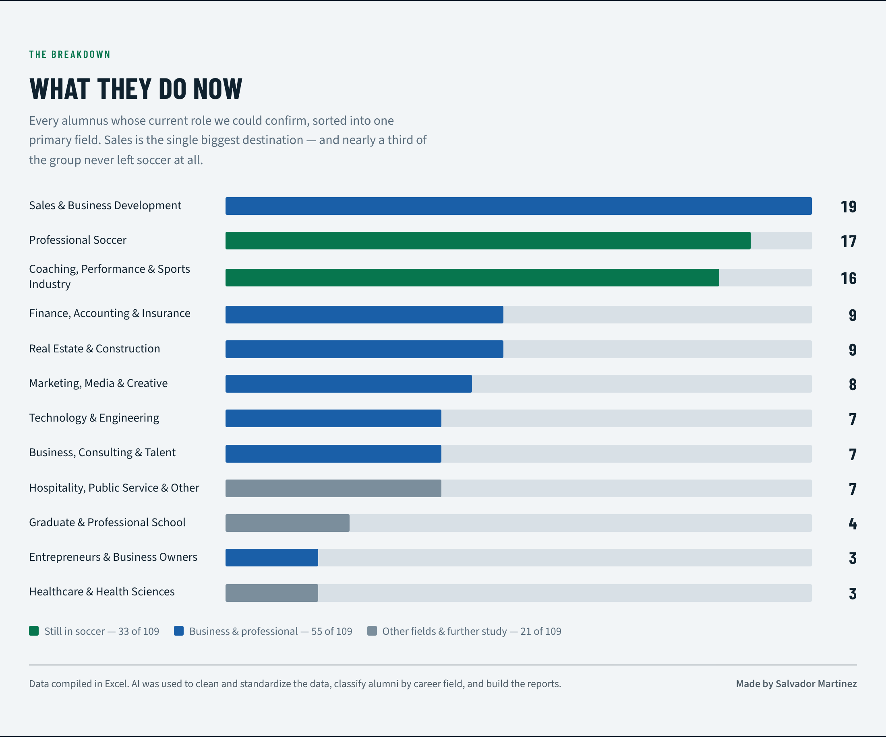

# FGCU Men's Soccer Alumni: Career Outcomes Analysis

A data project that turned scattered alumni records into one clean database, then answered a simple question for the coaching staff: **what do players do after college?**



## The problem

FGCU Athletics kept information on former student-athletes in different platforms and spreadsheets. There was no single database, so nobody could say where alumni ended up or how to reach them. For a coach talking to recruits, "what happens after college?" had no data behind the answer.

## What I did

1. **Consolidated** the roster records for 176 men's soccer letterwinners (2007 to 2025) into one dataset.
2. **Researched** each person's current job, location, LinkedIn and other contact details by hand.
3. **Cleaned** the raw data in PostgreSQL: standardized graduation terms, phone formats and emails, and removed placeholder values.
4. **Classified** each confirmed job into one of 12 career fields.
5. **Analyzed** the results with SQL and delivered a recruiting report and an alumni directory to the coaching staff.

## Key findings

Career paths were confirmed for **109 of 176** alumni (62%).

| Career field | Alumni | Share of confirmed |
|---|---:|---:|
| Sales & Business Development | 19 | 17.4% |
| Professional Soccer | 17 | 15.6% |
| Coaching, Performance & Sports Industry | 16 | 14.7% |
| Finance, Accounting & Insurance | 9 | 8.3% |
| Real Estate & Construction | 9 | 8.3% |
| Marketing, Media & Creative | 8 | 7.3% |
| Technology & Engineering | 7 | 6.4% |
| Business, Consulting & Talent | 7 | 6.4% |
| Hospitality, Public Service & Other | 7 | 6.4% |
| Graduate School & Continuing Ed | 4 | 3.7% |
| Entrepreneurs & Owners | 3 | 2.8% |
| Healthcare & Health Sciences | 3 | 2.8% |

- **Sales is the most common destination**, ahead of any other field.
- **33 alumni (30%) stayed in soccer** as professional players, coaches, trainers or agents.
- **136 of 176 (77%)** can be reached through at least one channel. The 40 with no contact information are nearly all older players with no graduation term on record.
- Alumni now work in **17 countries**.

## Data cleaning

The raw data was entered by hand over time, so the same fact appears in several formats. `sql/01_clean.sql` standardizes it without ever editing the raw table.

| Problem in the raw data | Raw value | After cleaning |
|---|---|---|
| Graduation term includes the season | `Summer 2025` | `2025` |
| Unknown graduation term | `n/a` | `NULL` |
| Phone formats differ | `7056482317` | `(705) 648-2317` |
| International prefix typed as `00+` | `00+49 603 73 51 33` | `+49 603 73 51 33` |
| Placeholder ID from a failed record match | `NO MATCH` | `NULL` |
| Person has two emails | personal and school | personal kept, school used only as fallback |
| "We looked and found nothing" typed as `?` | `?` | `NULL` |

## Example query

```sql
-- What do alumni do now, and what share does each field represent?
SELECT category,
       COUNT(*) AS alumni,
       ROUND(100.0 * COUNT(*) / (SELECT COUNT(*) FROM alumni_clean WHERE job IS NOT NULL), 1) AS pct
FROM alumni_clean
WHERE job IS NOT NULL
GROUP BY category
ORDER BY alumni DESC;
```

`sql/02_analysis.sql` has ten queries like this one. Each has the expected result in a comment.

## Run it yourself

You need PostgreSQL (tested on version 16).

```bash
# 1. create a database
createdb fgcu_alumni

# 2. create the tables, load the data, clean it, analyze it
psql -d fgcu_alumni -f sql/00_setup.sql
psql -d fgcu_alumni -c "\copy raw_alumni FROM 'data/raw_alumni_synthetic.csv' WITH (FORMAT csv, HEADER true)"
psql -d fgcu_alumni -c "\copy category_lookup FROM 'data/category_lookup_synthetic.csv' WITH (FORMAT csv, HEADER true)"
psql -d fgcu_alumni -f sql/01_clean.sql
psql -d fgcu_alumni -f sql/02_analysis.sql
```

Check: `SELECT COUNT(*) FROM alumni_clean;` should return 176.

## About the data in this repo

**The files in `data/` are synthetic.** The real records include personal phone numbers and emails of former students, so they stay private. `scripts/generate_synthetic_data.py` creates fake people with the same columns, the same kinds of messy values, and the same overall counts, so every query runs and returns the results above. No real names or contact details are in this repo.

## Limitations

- **38% of alumni have no confirmed career.** They skew toward older players, so the findings describe the people who are easiest to find.
- **People with public LinkedIn profiles are easier to confirm**, which may over-represent office and professional careers.
- **Each person has one career field**, assigned by reading their job title. Someone who coaches and runs a business appears once.
- Job information comes from public profiles and may be out of date.

## Tools

- **Excel** to collect and organize the source records and do the manual research
- **PostgreSQL** to clean, standardize and analyze the data
- **AI assistance** to standardize values, classify job titles into career fields, and build the reports and charts

## Next steps

- Repeat the process for the other FGCU sports
- Build a Power BI dashboard on top of `alumni_clean`
- Add a "last verified" date so stale records are easy to spot

## Repo structure

```
data/      synthetic raw data and category lookup
sql/       00_setup, 01_clean, 02_analysis
scripts/   generate_synthetic_data.py
images/    charts from the project
docs/      data dictionary
```

*Built by Salvador Martinez, M.S. Data Analytics & AI, Florida Gulf Coast University.*
